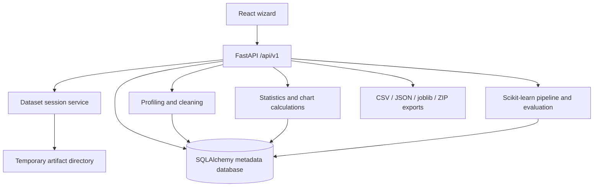

# Architecture

## Runtime request path

Database selection is controlled only by `DATABASE_URL`: local development uses MySQL through PyMySQL, production uses Neon PostgreSQL through psycopg3, and automated tests use in-memory SQLite. ORM models and services are shared across environments; Alembic manages schema changes.

## Data separation

- `original_upload_path`: byte-for-byte uploaded file retained in temporary storage.
- `original_dataframe_path`: app-generated parsed dataframe used as the immutable initial representation.
- `cleaned_dataframe_path`: app-generated working dataframe that changes only when an explicit cleaning action is applied.
- `data_revision`: incremented after cleaning to prevent evaluating a model comparison against changed data.
- `cleaning_logs`: append-only records of applied cleaning actions.
- `chart_runs`: chart configuration and chart-ready data tied to the data revision.
- `model_runs`: chosen target, candidate comparison, saved train/test split, selected model, evaluation and artifact references.

## Model evaluation integrity

1. Missing target labels are excluded from the labelled modelling rows.
2. Identifier-like, constant and all-missing columns are excluded from features by default.
3. A stratified holdout split is created once and its row positions are stored for the comparison run.
4. Dummy Classifier, Logistic Regression and Random Forest are compared using cross-validation on the training rows.
5. The UI ranks models using a user-selected CV metric.
6. The user-selected model is fitted on the same training partition and evaluated on the held-out test partition.
7. Cleaning increments `data_revision`, so a stale comparison cannot be evaluated against changed data.

## Boundaries

This is a modular monolith, not microservices. FastAPI route files validate requests and delegate to services. Services manage data processing, charts, model training and exports. The frontend uses route-separated pages and a shared navigation shell.
