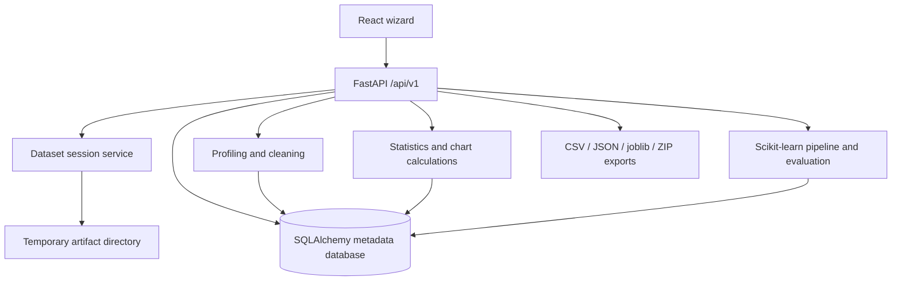

# Architecture

## Runtime request path

Database selection is controlled only by `DATABASE_URL`: local development uses MySQL through PyMySQL, production uses Neon PostgreSQL through psycopg3, and automated tests use in-memory SQLite. ORM models and services are shared across environments; Alembic manages schema changes.

## Data separation

- `original_upload_path`: byte-for-byte uploaded file retained in temporary storage.
- `original_dataframe_path`: app-generated parsed dataframe used as the immutable initial representation.
- `cleaned_dataframe_path`: app-generated working dataframe that changes only when an explicit cleaning action is applied.
- `data_revision`: incremented after cleaning to prevent predicting with a model trained on an earlier dataset revision.
- `cleaning_logs`: append-only records of applied cleaning actions.
- `chart_runs`: chart configuration and chart-ready data tied to the data revision.
- `model_runs`: chosen target, detected task, saved train/test split, evaluation metrics and fitted pipeline reference.

## Model training and prediction

1. Missing target labels are excluded from the labelled modelling rows.
2. Identifier-like, constant, high-cardinality, mostly-missing and all-missing columns are excluded from targets or features by default.
3. Classification uses a stratified holdout; regression uses a random holdout.
4. One Random Forest model matching the detected task is fitted on the training rows and scored on held-out rows.
5. The same preprocessing and model pipeline is refit on all labeled rows and saved for interactive single-record prediction.
6. Prediction inputs are checked against the saved feature schema; unseen categories are accepted by the encoder and reported to the user.
7. Cleaning increments `data_revision`, so a model trained against older data cannot be used for prediction.

## Boundaries

This is a modular monolith, not microservices. FastAPI route files validate requests and delegate to services. Services manage data processing, charts, model training and exports. The frontend uses route-separated pages and a shared navigation shell.
